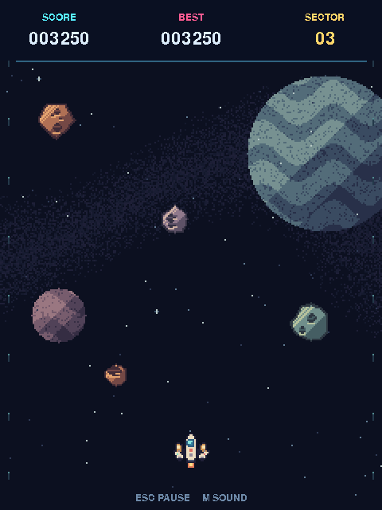
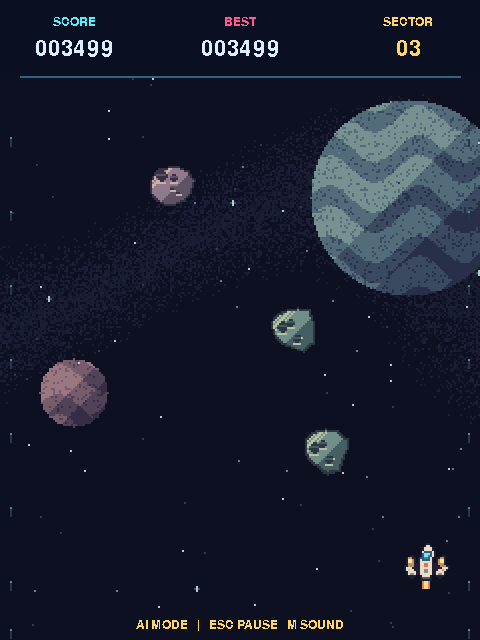
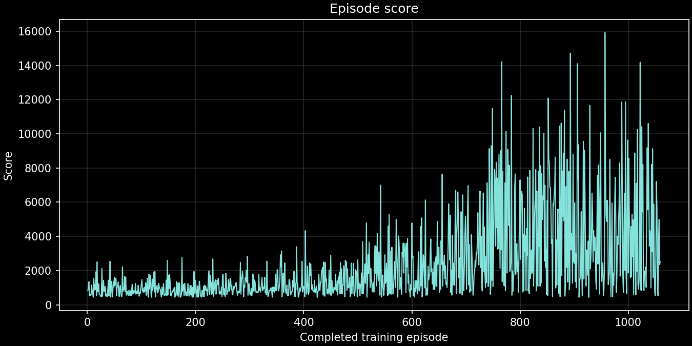
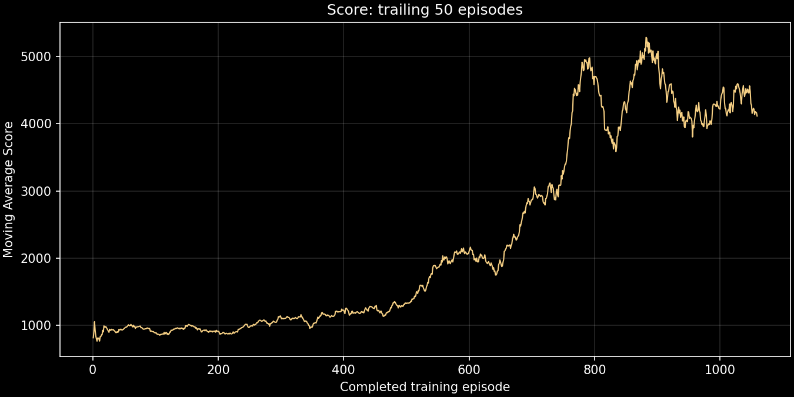
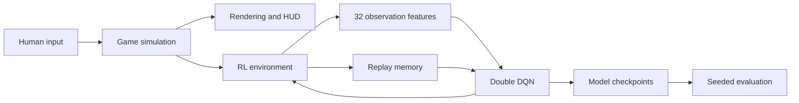

# Space Courier

**A playable arcade game and reproducible reinforcement learning experiment.**



Space Courier is a Python arcade survival game in which a delivery shuttle navigates an increasingly difficult asteroid field. Alongside human gameplay, the project includes a PyTorch Double DQN agent trained through interaction with the same game simulation.

[Experiment methodology](AI_EXPERIMENT.md) · [Gameplay source](game/) · [AI implementation](ai/) · [Tests](tests/)

## Reinforcement learning results



| Policy | Mean score |
| --- | ---: |
| Random | 873.5 |
| Double DQN | 7,311 |

The delivered model achieved **8.37× the random policy's mean score** across 100 held-out games using matching obstacle seeds. Evaluation episodes were capped at 180 seconds; two learned runs reached that cap. The agent can still crash early. These are repository-reported experimental results, not a guarantee of performance in every run.




## Technical highlights

- Python game simulation separated from rendering and input.
- Double DQN implemented with PyTorch, replay memory and a target network.
- 32 numerical observations and three discrete actions.
- Network architecture: 32 → 128 → 128 → 3.
- Headless training, saved checkpoints and visual inference.
- Seeded evaluation against a random baseline.
- Automated gameplay and AI regression tests.
- Locally generated art and audio; no external asset downloads required.

## Architecture



## Play the game

Requires Python 3.10 or newer.

```sh
git clone https://github.com/DarthPlagueis123/SpaceCourier.git
cd SpaceCourier
python -m pip install -r requirements.txt
python main.py
```

## Watch the trained agent

```sh
python -m pip install -r requirements-ai.txt
python main.py --ai
```

The title screen also offers **I: Watch AI**. Human gameplay does not require the AI dependencies.

## Controls

| Key | Action |
| --- | --- |
| Left / A, Right / D | Move |
| Enter / Space | Start or restart; select pause option |
| I (title screen) | Watch the trained AI |
| Escape | Pause / resume; return from game over; quit title |
| Up / Down or W / S | Navigate pause menu |
| R | Restart while paused or after death |
| M | Toggle sound |

The window can be resized and uses crisp integer scaling where possible. Losing window focus pauses an active run. High scores save in `%LOCALAPPDATA%/PixelPanic/scores.json` (or your home directory on other platforms). Unavailable sound or unwritable score storage does not prevent playing.

## Project structure

```text
SpaceCourier/
  main.py             Entry point
  requirements.txt
  game/
    settings.py       Resolution, palette, movement constants
    model.py          Player, obstacles, scoring, difficulty, collisions
    game.py           Input, screens, HUD, persistence, main loop
    art.py            Handmade sprites, layered space scenery, particles
    audio.py          Original synthesized arcade sound effects
  tests/
    test_game.py      Gameplay and menu regression checks
```

Art and sounds are generated locally: no external assets or downloads are needed. Movement and falling hazards use elapsed time. The player has a forgiving collision circle, and one meteor spawns per wave. Falling speed and spawn frequency increase gradually over 90 seconds, then cap. Score awards 100 points per survival second.

## Verification

```sh
python -m unittest discover -s tests -v
```

Tests use SDL's dummy video/audio drivers and temporary score storage.

## Reproduce the experiment

AI runs do not overwrite human high scores. You can load older checkpoints:

```sh
python main.py --ai --model models/checkpoints/step_0050000.pth
python main.py --ai --debug --seed 100002
```

Train another experiment without overwriting this run:

```sh
python -m ai.train --steps 250000 --output experiments/run_02
python -m ai.evaluate --model models/best_model.pth --episodes 100 --output results/recheck
```

Add `--render` to training for an uncapped visual debugging mode. Training is headless by default. Closing its debug window or pressing Ctrl+C saves completed-episode data and the current model, then evaluates it. Choose a fresh output directory for every experiment. Evaluation automatically runs random and learned policies on matching obstacle seeds.

The delivered model averaged **7,311 points** versus **873.5** for random play on 100 held-out games: **8.37 times** the mean score. Both evaluations use a 180-second cap; two learned runs reached it. The agent still sometimes crashes early.

See [AI_EXPERIMENT.md](AI_EXPERIMENT.md) for the exact observations, reward, hyperparameters, training record, limitations, and artifact map.


## Future experiments

- Compare against a deterministic heuristic and alternative RL algorithms.
- Train with multiple independent random seeds and report variability.
- Evaluate robustness under different obstacle distributions.
- Package downloadable builds and capture a short gameplay comparison.

## Author

Nathan Kransfeld — software development, artificial intelligence and interactive applications.

[GitHub profile](https://github.com/DarthPlagueis123) · [Kransfeld Studios](https://kransfeldstudios.com)
